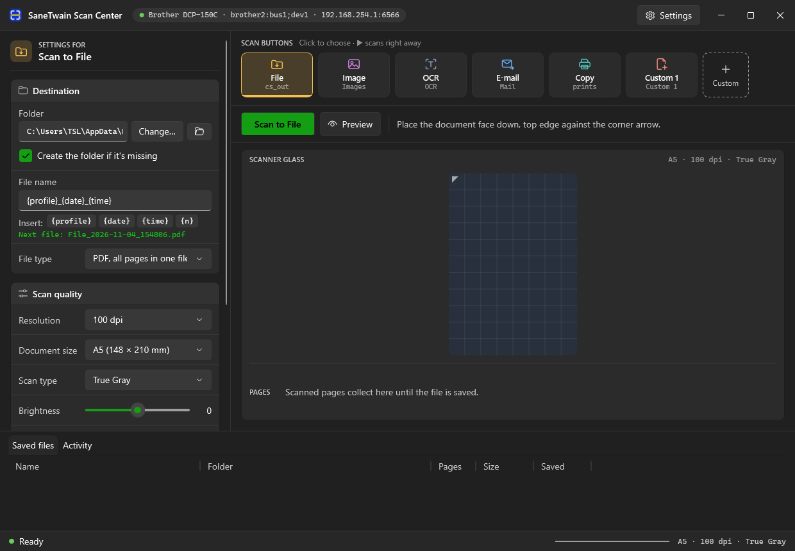

# SaneTwain Scan Center

A modern Windows app for scanners shared over the network with SANE (`saned`). It replaces the SaneTwain
window with ControlCenter3-style scan buttons (File, Image, OCR, E-mail, Copy and your own). Each button
saves straight into its own folder as soon as the scan ends.



- **One click per job.** Each scan button has its own folder, file name pattern, file type, resolution,
  scan type and after-save action (show in folder, open, e-mail, print).
- **No Save dialog.** With **Write file to disk** ticked (per button), files are written as soon as the
  scan finishes. Otherwise one click on **Save file** writes them. Missing folders are created, and nothing
  is overwritten.
- **PDF, searchable PDF (Windows OCR), TIFF, JPEG and PNG.** Multi-page documents from the glass or a document feeder.
- **Windows 11 native.** Fluent design, dark by default, immersive title bar with snap layouts, a
  notification-area icon that shows the scanner status, start with Windows, and MSIX packaging for the Microsoft Store.
- **Works with SaneTwain.** It reads `sanetwain.ini` on first start and keeps the connection settings in sync.

**User guide:** [docs/GUIDE.md](docs/GUIDE.md)

## Repository layout

| Folder | What it is |
|---|---|
| `csharp/` | **The current app.** C# / WPF on .NET 10, with MSIX packaging. See [csharp/README.md](csharp/README.md). |
| `sanescan/`, `scancenter.pyw`, `Scan Center.bat` | The first version, in Python and PySide6. It still works. See [docs/python-version.md](docs/python-version.md). |
| `docs/` | User guide, screenshot, and the interactive design mockups (`docs/mockups/*.html`, open them in a browser). |

## Quick start (C# app)

```powershell
cd csharp
dotnet run --project src\ScanCenter.App
```

To build and install the MSIX package, see [docs/GUIDE.md](docs/GUIDE.md#install).

## Requirements

- Windows 10 2004 (build 19041) or later. Windows 11 recommended.
- A computer on your network running `saned` with the scanner attached. For example, a Linux box or NAS
  with `sane-utils`, and the `brother2` backend for older Brother models.
- To build: the .NET 10 SDK. For packaging, also the Windows 10/11 SDK.
